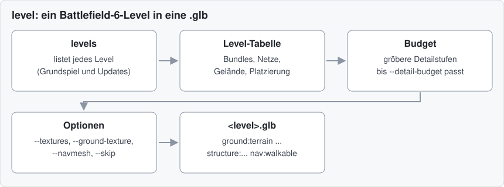

# Battlefield-6-Level: `levels` und `level` {#battlefield-6-levels-levels-and-level}

**Was ist das?** Ein ganzes Battlefield-6-Level als eine 3D-Datei. **Warum?** Damit
die Hitze aus deinen Partien das Gelände und die Gebäude darunter hat. (*Frostbite* ist
die Engine, mit der Battlefield gemacht ist; ein *Höhenfeld* ist das Gelände als
Raster aus Höhen gespeichert.)

Exportiert ein ganzes Frostbite-Level des installierten Spiels: das Höhenfeld des
Geländes, jedes Mesh, das seine statischen Modellgruppen platzieren, die einzeln
platzierten Objekte, den Geländehintergrund um die Karte und auf Wunsch die
Farbkarten der Oberflächen, die in den Boden eingebackenen Gelände-Decals und die
begehbaren Flächen der Soldaten.



## Schritt für Schritt {#step-by-step}

1. **Die Levels auflisten**, die das Spiel mitbringt:

   ```
   heat3d-battlefield-maps levels
   heat3d-battlefield-maps levels --install "D:\Games\<game folder>"
   ```

   Jede Zeile ist eine Level-Tabelle (`levels/<level>/<level>.toc`) mit ihrer Größe
   und ihrer Herkunft: `Data` für das Grundspiel, `Update/<pack>` für ein Update.

2. **Eines exportieren**, unter seinem Namen, einem eindeutigen Teil davon oder seinem
   `.toc`-Pfad. Beginne ohne Farbe, um Form und Größe zu sehen:

   ```
   heat3d-battlefield-maps level <level> -o level.glb
   ```

3. **Farbe hinzufügen**, sobald es richtig aussieht:

   ```
   heat3d-battlefield-maps level <level> -o level.glb --textures 512 --ground-texture 0.5
   ```

4. **Die begehbaren Flächen hinzufügen** oder die Datei verkleinern:

   ```
   heat3d-battlefield-maps level <level> --textures 512 --ground-texture 0.5 --navmesh
   heat3d-battlefield-maps level <level> --textures 256 --detail-budget 3000000 --ground-spacing 8
   ```

5. **`level.glb` öffnen** im Bereich Hintergrund / Level des 3DHeat-Viewers
   ([Level laden](https://holdi601.github.io/3DHeat/levels.html)).

## Optionen {#options}

| Option | Vorgabe | Bedeutung |
|---|---|---|
| `<level>` | Pflicht | ein Name, so wie `levels` ihn ausgibt, ein eindeutiger Teil davon oder die `.toc` eines Levels |
| `-o`, `--out FILE` | `<level>.glb` (in `$HEAT3D_LEVELS/<game>/`, wenn das gesetzt ist) | die zu schreibende Datei |
| `--install FOLDER` | in den Steam-Bibliotheken gefunden, dann in den Ordnern der EA-App, von Origin und Epic | der Spielordner |
| `--textures [PIXELS]` | aus; ohne Größe 512 | die Farbkarte jeder Oberfläche, höchstens PIXELS an einer Seite |
| `--ground-texture [METRES]` | aus; ohne Größe 0,5 | Straßen, Vorfelder und Markierungen in die Bodenfarbe einbacken, METRES pro Pixel |
| `--navmesh` | aus | das Navigationsmesh der Soldaten als `nav:walkable` hinzufügen |
| `--ground-spacing METRES` | 4 | der feinste Abstand des Höhenfeldes; 0 lässt es weg |
| `--detail-budget N` | die gröbsten Kopien plus ein Viertel, mindestens 1.500.000 | eine Obergrenze für Dreiecke (das Gelände wird nie vergröbert) |
| `--skip TEXT` | | Modellgruppen auslassen, deren Partitionsname TEXT enthält; wiederholbar |
| `--by-mesh` | aus | ein Teil je Quell-Mesh und Material, um zu finden, was ein Teil ist |
| `--clamped-uvs` | aus | für Renderer, die eine Textur nicht wiederholen können |

Die vollständige Tabelle mit den zu erwartenden Größen (ein ganzes Level sind
Hunderte MB) steht [unten](#every-option-in-full); jede Option, so wie das Programm
sie ausgibt, steht unter [Befehlsreferenz](../cli-reference.md). Wie die
Tabellen, Bundles, Meshes und das Gelände gelesen werden, steht unter [Frostbite](reader-frostbite.md).

## Beispielausgabe {#example-output}

Was `level` ausgibt, im Überblick (die Zeilen so, wie der Code sie schreibt; `<n>`
und die Namen unterscheiden sich je Level):

```text
<n> copies of <n> meshes, from <n> static model groups
      <n>  <group>
      <n>  placed one by one (object and prefab references)
<n> meshes left out: <why>
<n> triangles, budget <n>; <n> meshes drawn at a coarser level to fit
           <n>  ground:terrain
           <n>  structure:buildings, <n> textures
           ...
<n> of <n> drawn sections carry their colour map; the rest are flat colours
Ground: <what the ground is>.
Navigation mesh: <tiles read>.
-> level.glb (<n> MB)
```

## Die Teile {#the-parts}

`ground:terrain` (das Höhenfeld), `ground:terrain backdrop` und
`ground:terrain blend`, `structure:<kind>` je Art von Mesh (je Farbkarte mit
`--textures`, mit ` (destructible)` für das, was ein Match zerstören kann), und
`nav:walkable` mit `--navmesh`. Siehe [Ausgabeformat](https://holdi601.github.io/3DHeat-GameFiles/output-format.html).

Die Datei enthält die Inhalte des Spiels: Sie ist für den Rechner gedacht, auf dem
sie entstanden ist, nicht zum Weitergeben ([Bedingungen und Lizenz](terms.md)).

## Wo das Spiel gefunden wird {#where-the-game-is-found}

`--install` zuerst. Ohne diese Option das erste Spiel, dessen `Data`-Ordner eine
`layout.toc` enthält (das Kennzeichen einer Frostbite-Installation): im Ordner
`steamapps\common` jeder Steam-Bibliothek (Steams eigener Ordner und jede Bibliothek,
die ihre `libraryfolders.vdf` auflistet), dann in den Standardordnern der EA-App
(`C:\Program Files\EA Games`), von Origin (`C:\Program Files (x86)\Origin Games`) und
dem Epic-Games-Launcher (`C:\Program Files\Epic Games`). `levels` gibt in seiner ersten
Zeile den Ordner aus, den es benutzt hat; wenn du es einmal startest, siehst du also,
ob das richtige Spiel gefunden wurde.

## Alle Optionen im Detail {#every-option-in-full}

```
heat3d-battlefield-maps levels [--install FOLDER]
heat3d-battlefield-maps level <level> [-o FILE] [--install FOLDER] [--textures [PIXELS]]
                              [--ground-texture [METRES]] [--ground-spacing METRES]
                              [--navmesh] [--detail-budget N] [--skip TEXT ...] [--by-mesh]
                              [--clamped-uvs]
```

`levels` listet die Levels, die ein installiertes Frostbite-Spiel mitbringt, nach dem
Namen ihrer Tabelle (`levels/<level>/<level>.toc`), mit Größe und Herkunft: `Data` für
das Grundspiel, `Update/<pack>` für ein Update, und wie viele hochauflösende Tabellen
dazukommen. Ein Level, das ein Update ausliefert, hat im Grundspiel ebenfalls nur eine
kleine Tabelle mit Chunks; die Tabelle mit den Bundles des Levels ist das Level (siehe
[Frostbite](reader-frostbite.md#which-table-is-the-level)). `level` exportiert eines:
das Höhenfeld des Geländes, jedes Mesh, das die statischen Modellgruppen des Levels
platzieren, die einzeln platzierten Objekte, wo sie stehen, und den Geländehintergrund
des Levels rund um die Karte. Mit `--textures` trägt jede Oberfläche ihre Farbkarte;
mit `--navmesh` kommen auch die Oberflächen dazu, auf denen Soldaten gehen.

| Option | Vorgabe | Bedeutung |
|---|---|---|
| `<level>` | Pflicht | ein Name, so wie `levels` ihn ausgibt, ein eindeutiger Teil davon oder der Pfad der `.toc` eines Levels |
| `-o`, `--out FILE` | `<level>.glb` (in `$HEAT3D_LEVELS/<game>/`, wenn das gesetzt ist) | die zu schreibende `.glb` |
| `--install FOLDER` | das erste Spiel, dessen `Data` eine `layout.toc` hat, [wie oben](#where-the-game-is-found) | der Spielordner |
| `--textures [PIXELS]` | aus; ohne Größe 512 | schreibt die Farbkarte jeder Oberfläche, die größte Mipmap höchstens PIXELS an einer Seite, und ihre Texturkoordinaten, so wie das Spiel sie hat, mit einem sich wiederholenden Sampler (siehe [Ausgabeformat](https://holdi601.github.io/3DHeat-GameFiles/output-format.html)). Das Höhenfeld bekommt die Farbkarte des Geländehintergrunds, wo diese Karte es abdeckt; sonst die mittlere Farbe der Oberflächenmaterialien des Geländes; sonst die mittlere Farbe des Hintergrunds ringsum. Ohne diese Option ist jeder Teil eine einfache Farbe |
| `--ground-texture [METRES]` | aus; ohne Größe 0,5 | bäckt die Gelände-Decals (Straßen, Landebahnen, Vorfelder, aufgemalte Markierungen) über die Bodenfarbe ins Höhenfeld, multipliziert mit der Farbkarte des Geländes, wo das Level eine hat; METRES pro Pixel, in Kacheln von höchstens 4.096 Pixeln (`ground:terrain x<x> z<z>`). Funktioniert mit oder ohne `--textures` |
| `--navmesh` | aus | fügt das Navigationsnetz des Levels für seinen kleinsten Agenten hinzu, den Soldaten (1,8 m hoch, 0,4 m breit), als Teil `nav:walkable`: den Boden, Böden, Treppen und die Dächer, die ein Soldat erreichen kann, ohne die Verbindungen (Sprünge, Leitern, Übersteigen) zwischen ihnen |
| `--ground-spacing METRES` | 4 | der feinste Abstand des Höhenfeldes; feinere Knoten werden auf diesen Abstand abgetastet. 0 lässt das Höhenfeld weg |
| `--detail-budget N` | jede Kopie in ihrer gröbsten Stufe, plus ein Viertel, mindestens 1.500.000 | eine Obergrenze für Dreiecke. Die Meshes mit den höchsten Kosten verlieren jeweils eine Detailstufe, bis es passt; reichen auch die gröbsten Stufen nicht, fallen zuerst die kleinsten Kopien weg. Der Geländehintergrund wird nie vergröbert oder weggelassen |
| `--skip TEXT` | | lässt statische Modellgruppen weg, deren Partitionsname TEXT enthält; mehrfach angebbar. Zum Beispiel die Ebene eines Spielmodus |
| `--by-mesh` | aus | zum Finden, was ein Teil ist: ein Teil je Quell-Mesh und Material, benannt `<part> \| <mesh> \| <material>`; eine viel größere Datei |
| `--clamped-uvs` | aus | für einen Renderer, der eine Textur nicht wiederholen kann: jedes texturierte Dreieck wird in Stücke geschnitten, deren Koordinaten in 0..1 liegen; ein Dreieck, das mehr als 4 Stücke bräuchte, wird in der durchschnittlichen Farbe seiner Textur gezeichnet, in einem Teil `<part> (average colour)` |

Es gibt aus: die Gruppen und wie viele Kopien jede davon platziert hat, die ausgelassenen
Meshes und warum, die Dreiecke je Teil (und mit `--textures`, wie viele Texturen es gibt
und wie viele Abschnitte ihre Farbkarte gefunden haben), wie der Boden beschaffen ist und
mit `--navmesh`, wie viele Navigationskacheln gelesen wurden. Über die Geometrie hinaus
wird nichts über das Level geschrieben: keine Namen, keine Metadaten (siehe
[Ausgabeformat](https://holdi601.github.io/3DHeat-GameFiles/output-format.html)).

Das Budget fürs Gelände ist getrennt: Höhenfeld und Hintergrund werden von
`--detail-budget` nie vergröbert; `--ground-spacing` bestimmt das Höhenfeld.

Ein ganzes Level ist groß: meist über zehn Millionen Dreiecke und mehrere hundert MB.
`--textures` fügt der Datei wenig hinzu; ein Level mit vielen Bäumen kann etwa 1 GB
erreichen. `--textures 256 --detail-budget 3000000 --ground-spacing 8` bringt ein Level
auf etwa ein Drittel davon.

## Meldungen und Exit-Status {#messages-and-exit-status}

| Meldung | Exit | Bedeutung |
|---|---|---|
| `no Frostbite game found in a Steam library or the EA app's, Origin's or Epic's folder; give --install <the game's folder>` | 2 | das Spiel installieren oder `--install` angeben |
| `needs 3DHeat GameFiles: ...` | 2 | 3DHeat GameFiles installieren ([Bevor du anfängst](before-you-start.md)) |
| sonst, nach den Zählungen | 1 | eine Level-Tabelle oder ein Bundle ließ sich nicht lesen; die Zeile sagt, welche |

0 heißt, das Level wurde geschrieben; die letzte Zeile ist `-> <file> (<n> MB)`.

## Über 3DHeat GameFiles {#through-3dheat-gamefiles}

Die eigenen `levels` und `level` von 3DHeat GameFiles starten dieses Werkzeug mit denselben
Argumenten, also tut `python -m heat3d_gamefiles level <level> -o level.glb` dasselbe,
sobald beides installiert ist.
