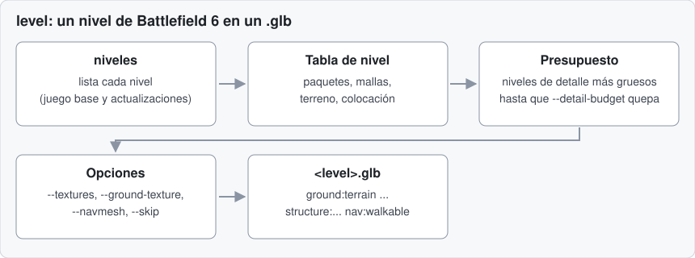

# Niveles de Battlefield 6: `levels` y `level` {#battlefield-6-levels-levels-and-level}

**¿Qué es?** Un nivel completo de Battlefield 6 como un único archivo 3D. **¿Para qué?** Para que el calor de tus partidas tenga debajo el suelo y los edificios. (*Frostbite* es el motor con el que está hecho Battlefield; un *campo de alturas* es el suelo guardado como una rejilla de alturas.)

Exporta un nivel completo de Frostbite del juego instalado: el campo de alturas del terreno, cada malla que colocan sus grupos de modelos estáticos, los objetos colocados uno a uno, el fondo del terreno alrededor del mapa, y, si se pide, los mapas de color de las superficies, las calcomanías del terreno horneadas en el suelo y las superficies transitables de los soldados.



## Paso a paso {#step-by-step}

1. **Listar los niveles** que trae el juego:

   ```
   heat3d-battlefield-maps levels
   heat3d-battlefield-maps levels --install "D:\Games\<game folder>"
   ```

   Cada línea es una tabla de nivel (`levels/<level>/<level>.toc`) con su tamaño y de dónde viene: `Data` para el juego base, `Update/<pack>` para una actualización.

2. **Exportar uno**, por su nombre, una parte única de él o su ruta `.toc`. Empieza sin textura para ver la forma y el tamaño:

   ```
   heat3d-battlefield-maps level <level> -o level.glb
   ```

3. **Añade color** una vez que se vea bien:

   ```
   heat3d-battlefield-maps level <level> -o level.glb --textures 512 --ground-texture 0.5
   ```

4. **Añade las superficies transitables**, o reduce el archivo:

   ```
   heat3d-battlefield-maps level <level> --textures 512 --ground-texture 0.5 --navmesh
   heat3d-battlefield-maps level <level> --textures 256 --detail-budget 3000000 --ground-spacing 8
   ```

5. **Abre `level.glb`** en el panel Fondo / nivel del visor de 3DHeat ([cargar un nivel](https://holdi601.github.io/3DHeat/levels.html)).

## Opciones {#options}

| Opción | Por defecto | Significado |
|---|---|---|
| `<level>` | obligatorio | un nombre tal como lo imprime `levels`, una parte única de uno, o la `.toc` de un nivel |
| `-o`, `--out FILE` | `<level>.glb` (en `$HEAT3D_LEVELS/<game>/` cuando eso está definido) | el archivo que se escribe |
| `--install FOLDER` | se busca en las bibliotecas de Steam, luego en las carpetas de la aplicación de EA, Origin y Epic | la carpeta del juego |
| `--textures [PIXELS]` | desactivado; 512 sin tamaño | el mapa de color de cada superficie, como mucho PIXELS por lado |
| `--ground-texture [METRES]` | desactivado; 0.5 sin tamaño | hornea carreteras, plataformas y marcas en el color del suelo, METRES por píxel |
| `--navmesh` | desactivado | añade la malla de navegación del soldado como `nav:walkable` |
| `--ground-spacing METRES` | 4 | la separación más fina del campo de alturas; 0 lo deja fuera |
| `--detail-budget N` | las copias más gruesas más un cuarto, como mínimo 1.500.000 | un techo de triángulos (el terreno nunca se simplifica) |
| `--skip TEXT` | | deja fuera los grupos de modelos cuyo nombre de partición contiene TEXT; se puede repetir |
| `--by-mesh` | desactivado | una parte por malla de origen y material, para averiguar qué es una parte |
| `--clamped-uvs` | desactivado | para visores que no pueden repetir una textura |

La tabla completa, con los tamaños que cabe esperar (un nivel completo son cientos de MB), está [más abajo](#every-option-in-full); cada opción tal como la imprime el programa está en [Referencia de comandos](../cli-reference.md). Cómo se leen las tablas, paquetes, mallas y el terreno está en [Frostbite](reader-frostbite.md).

## Salida de ejemplo {#example-output}

Lo que imprime `level`, en resumen (las líneas tal como las escribe el código; `<n>` y los nombres cambian según el nivel):

```text
<n> copies of <n> meshes, from <n> static model groups
      <n>  <group>
      <n>  placed one by one (object and prefab references)
<n> meshes left out: <why>
<n> triangles, budget <n>; <n> meshes drawn at a coarser level to fit
           <n>  ground:terrain
           <n>  structure:buildings, <n> textures
           ...
<n> of <n> drawn sections carry their colour map; the rest are flat colours
Ground: <what the ground is>.
Navigation mesh: <tiles read>.
-> level.glb (<n> MB)
```

## Las partes {#the-parts}

`ground:terrain` (el campo de alturas), `ground:terrain backdrop` y `ground:terrain blend`, `structure:<kind>` por tipo de malla (por mapa de color con `--textures`, con ` (destructible)` para lo que puede destruirse en una partida), y `nav:walkable` con `--navmesh`. Ver [Formato de salida](https://holdi601.github.io/3DHeat-GameFiles/output-format.html).

El archivo contiene el contenido del juego: es para la máquina en la que se hizo, no para pasarlo de un lado a otro ([Condiciones y licencias](terms.md)).

## Dónde se encuentra el juego {#where-the-game-is-found}

`--install` primero. Sin él, el primer juego cuya carpeta `Data` contiene un `layout.toc` (la marca de una instalación de Frostbite): en `steamapps\common` de cada biblioteca de Steam (la carpeta de Steam y cada biblioteca que enumera su `libraryfolders.vdf`), luego en las carpetas por defecto de la aplicación de EA (`C:\Program Files\EA Games`), de Origin (`C:\Program Files (x86)\Origin Games`) y del lanzador de Epic Games (`C:\Program Files\Epic Games`). `levels` imprime la carpeta que usó en su primera línea, así que ejecutarlo una vez te dice si se encontró el juego correcto.

## Todas las opciones {#every-option-in-full}

```
heat3d-battlefield-maps levels [--install FOLDER]
heat3d-battlefield-maps level <level> [-o FILE] [--install FOLDER] [--textures [PIXELS]]
                              [--ground-texture [METRES]] [--ground-spacing METRES]
                              [--navmesh] [--detail-budget N] [--skip TEXT ...] [--by-mesh]
                              [--clamped-uvs]
```

`levels` lista los niveles que trae un juego Frostbite instalado, por el nombre de su tabla (`levels/<level>/<level>.toc`), con su tamaño y de dónde viene: `Data` para el juego base, `Update/<pack>` para una actualización, y cuántas tablas de alta resolución añaden a ese nivel. Un nivel que trae una actualización tiene también en el juego base una pequeña tabla de fragmentos; la tabla con los paquetes del nivel es el nivel (mira [Frostbite](reader-frostbite.md#which-table-is-the-level)).
`level` exporta uno: el campo de alturas del terreno, cada malla que colocan los grupos de modelos estáticos del nivel, los objetos colocados uno a uno, dónde están, y el fondo del terreno del nivel alrededor del mapa. Con `--textures`, cada superficie lleva su mapa de color; con `--navmesh`, también llegan las superficies por las que caminan los soldados.

| Opción | Por defecto | Significado |
|---|---|---|
| `<level>` | obligatorio | un nombre tal como lo imprime `levels`, una parte única de uno, o la ruta de la `.toc` de un nivel |
| `-o`, `--out FILE` | `<level>.glb` (en `$HEAT3D_LEVELS/<game>/` cuando eso está definido) | el `.glb` que se escribe |
| `--install FOLDER` | el primer juego cuya `Data` contiene un `layout.toc`, [como se indica arriba](#where-the-game-is-found) | la carpeta del juego |
| `--textures [PIXELS]` | desactivado; 512 si se indica sin tamaño | escribe el mapa de color de cada superficie, el mip más grande no mayor que PIXELS por lado, y sus coordenadas de textura tal como las tiene el juego, con un muestreador que repite (mira [Formato de salida](https://holdi601.github.io/3DHeat-GameFiles/output-format.html)). El campo de alturas recibe el mapa de color del fondo del terreno donde ese mapa lo cubre; si no, el color medio de los materiales de superficie del terreno; si no, el color promedio del fondo alrededor. Desactivado, cada parte es un color plano |
| `--ground-texture [METRES]` | desactivado; 0.5 si se indica sin tamaño | hornea las calcomanías del terreno —carreteras, pistas, plataformas, marcas pintadas— sobre el color del suelo, multiplicadas por el mapa de color del terreno donde el nivel lo tiene, dentro del color del campo de alturas, METRES por píxel, en losetas de como máximo 4.096 píxeles (`ground:terrain x<x> z<z>`). Funciona con o sin `--textures` |
| `--navmesh` | desactivado | añade la malla de navegación del nivel para su agente más pequeño, el soldado (1,8 m de alto, 0,4 m de ancho), como la parte `nav:walkable`: el suelo, los pisos, las escaleras y los tejados a los que puede llegar un soldado, sin los enlaces (saltos, escaleras de mano, pasos por encima) entre ellos |
| `--ground-spacing METRES` | 4 | la separación más fina del campo de alturas; los nodos más finos que esto se muestrean más gruesos. 0 deja fuera el campo de alturas |
| `--detail-budget N` | cada copia en su nivel más grueso, más un cuarto, como mínimo 1.500.000 | un techo de triángulos. Las mallas que más cuestan pierden un nivel de detalle cada vez hasta que caben; si ni los niveles más gruesos bastan, se dejan fuera primero las copias más pequeñas. El fondo del terreno nunca se simplifica ni se deja fuera |
| `--skip TEXT` | | deja fuera los grupos de modelos estáticos cuyo nombre de partición contiene TEXT; repítelo para varios. La capa de un modo de juego, por ejemplo |
| `--by-mesh` | desactivado | para averiguar qué es una parte: una parte por malla de origen y material, llamada `<part> \| <mesh> \| <material>`; un archivo mucho más grande |
| `--clamped-uvs` | desactivado | para un renderizador que no puede repetir una textura: corta cada triángulo texturizado en trozos cuyas coordenadas caen dentro de 0..1, y dibuja con el color medio de su textura un triángulo que necesitaría más de 4 trozos, en una parte `<part> (average colour)` |

Imprime los grupos y cuántas copias coloca cada uno, las mallas que dejó fuera y por qué,
los triángulos por parte (y con `--textures` cuántas texturas, y cuántas secciones encontraron su mapa de color), qué es el suelo, y con
`--navmesh` cuántas teselas de navegación se leyeron. No se escribe nada del nivel más allá de la
geometría: ni nombres ni metadatos (mira [Formato de salida](https://holdi601.github.io/3DHeat-GameFiles/output-format.html)).

El presupuesto del terreno es aparte: el campo de alturas y el fondo nunca se simplifican con `--detail-budget`; `--ground-spacing` dimensiona el campo de alturas.

Un nivel completo es grande: normalmente más de diez millones de triángulos y varios cientos de MB.
`--textures` añade un poco al archivo; un nivel con muchos árboles puede llegar a unos 1 GB.
`--textures 256 --detail-budget 3000000 --ground-spacing 8` reduce un nivel a aproximadamente un tercio de eso.

## Mensajes y código de salida {#messages-and-exit-status}

| Mensaje | Salida | Significado |
|---|---|---|
| `no Frostbite game found in a Steam library or the EA app's, Origin's or Epic's folder; give --install <the game's folder>` | 2 | instala el juego, o pasa `--install` |
| `needs 3DHeat GameFiles: ...` | 2 | instala 3DHeat GameFiles ([Antes de empezar](before-you-start.md)) |
| cualquier otro, tras los recuentos | 1 | no se pudo leer una tabla de nivel o un paquete; la línea dice cuál |

0 significa que el nivel se escribió; su última línea es `-> <file> (<n> MB)`.

## A través de 3DHeat GameFiles {#through-3dheat-gamefiles}

El propio `levels` y `level` de 3DHeat GameFiles ejecutan esta herramienta con los mismos
argumentos, así que `python -m heat3d_gamefiles level <level> -o level.glb` hace
lo mismo una vez que ambas estén instaladas.
