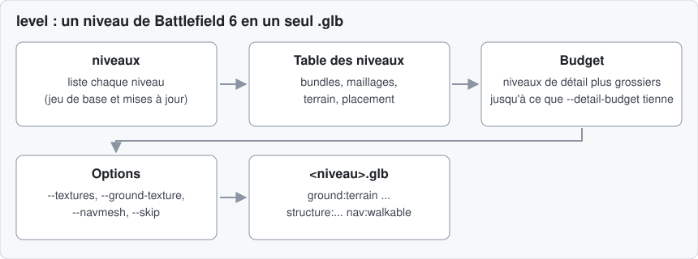

# Niveaux Battlefield 6 : `levels` et `level` {#battlefield-6-levels-levels-and-level}

**Qu'est-ce que c'est ?** Un niveau complet de Battlefield 6 en un seul fichier 3D.
**Pourquoi ?** Pour que la chaleur de vos parties ait dessous le sol et les bâtiments. (*Frostbite*
est le moteur avec lequel Battlefield est fait ; un *champ de hauteurs* est le sol stocké sous forme
de grille de hauteurs.)

Exporte un niveau Frostbite complet du jeu installé : le champ de hauteurs du terrain, chaque
maillage que placent ses groupes de modèles statiques, les objets placés un par un, le fond de
terrain autour de la carte, et, sur demande, les cartes de couleur des surfaces, les décalques de
terrain cuits dans le sol et les surfaces praticables par les soldats.



## Pas à pas {#step-by-step}

1. **Lister les niveaux** livrés avec le jeu :

   ```
   heat3d-battlefield-maps levels
   heat3d-battlefield-maps levels --install "D:\Games\<game folder>"
   ```

   Chaque ligne est une table de niveau (`levels/<level>/<level>.toc`) avec sa taille et son
   origine : `Data` pour le jeu de base, `Update/<pack>` pour une mise à jour.

2. **Exporter un niveau**, par son nom, une partie unique de celui-ci, ou son chemin `.toc`.
   Commencez sans texture pour voir la forme et la taille :

   ```
   heat3d-battlefield-maps level <level> -o level.glb
   ```

3. **Ajouter la couleur** une fois que cela a la bonne allure :

   ```
   heat3d-battlefield-maps level <level> -o level.glb --textures 512 --ground-texture 0.5
   ```

4. **Ajouter les surfaces praticables**, ou réduire le fichier :

   ```
   heat3d-battlefield-maps level <level> --textures 512 --ground-texture 0.5 --navmesh
   heat3d-battlefield-maps level <level> --textures 256 --detail-budget 3000000 --ground-spacing 8
   ```

5. **Ouvrez `level.glb`** dans le panneau Arrière-plan / niveau du visualiseur 3DHeat
   ([charger un niveau](https://holdi601.github.io/3DHeat/levels.html)).

## Options {#options}

| Option | Par défaut | Signification |
|---|---|---|
| `<level>` | obligatoire | un nom tel que l'affiche `levels`, une partie unique d'un nom, ou le `.toc` d'un niveau |
| `-o`, `--out FILE` | `<level>.glb` (dans `$HEAT3D_LEVELS/<game>/` quand cette variable est définie) | le fichier à écrire |
| `--install FOLDER` | trouvé dans les bibliothèques Steam, puis dans les dossiers de l'application EA, d'Origin et d'Epic | le dossier du jeu |
| `--textures [PIXELS]` | désactivé ; 512 sans valeur | la carte de couleur de chaque surface, au plus PIXELS de côté |
| `--ground-texture [METRES]` | désactivé ; 0.5 sans valeur | cuire routes, aires et marquages dans la couleur du sol, METRES par pixel |
| `--navmesh` | désactivé | ajoute le maillage de navigation du soldat comme `nav:walkable` |
| `--ground-spacing METRES` | 4 | l'écart le plus fin du champ de hauteurs ; 0 le laisse de côté |
| `--detail-budget N` | copies au niveau le plus grossier plus un quart, au moins 1 500 000 | un plafond de triangles (le terrain n'est jamais rendu plus grossier) |
| `--skip TEXT` | | laisse de côté les groupes de modèles dont le nom de partition contient TEXT ; répétable |
| `--by-mesh` | désactivé | une partie par maillage source et matériau, pour trouver ce qu'est une partie |
| `--clamped-uvs` | désactivé | pour les moteurs qui ne savent pas répéter une texture |

Le tableau complet, avec les tailles à attendre (un niveau entier fait des centaines de Mo), se
trouve [plus bas](#every-option-in-full) ; chaque option telle que le programme l'affiche est dans
[Commandes](../cli-reference.md). La manière dont les tables, bundles,
maillages et terrains sont lus est décrite dans [Frostbite](reader-frostbite.md).

## Exemple de sortie {#example-output}

Ce qu'affiche `level`, en gros (les lignes telles que le code les écrit ; `<n>` et les noms varient
selon le niveau) :

```text
<n> copies of <n> meshes, from <n> static model groups
      <n>  <group>
      <n>  placed one by one (object and prefab references)
<n> meshes left out: <why>
<n> triangles, budget <n>; <n> meshes drawn at a coarser level to fit
           <n>  ground:terrain
           <n>  structure:buildings, <n> textures
           ...
<n> of <n> drawn sections carry their colour map; the rest are flat colours
Ground: <what the ground is>.
Navigation mesh: <tiles read>.
-> level.glb (<n> MB)
```

## Les parties {#the-parts}

`ground:terrain` (le champ de hauteurs), `ground:terrain backdrop` et `ground:terrain blend`,
`structure:<kind>` par nature de maillage (par carte de couleur avec `--textures`, avec
` (destructible)` pour ce qu'une partie peut détruire), et `nav:walkable` avec `--navmesh`. Voir
[Format de sortie](https://holdi601.github.io/3DHeat-GameFiles/fr/output-format.html).

Le fichier contient le contenu du jeu : il est fait pour la machine où il a été produit, pas pour
circuler ([Règles et licences](terms.md)).

## Où le jeu est trouvé {#where-the-game-is-found}

`--install` d'abord. Sinon, le premier jeu dont le dossier `Data` contient un `layout.toc` (la marque
d'une installation Frostbite) : dans `steamapps\common` de chaque bibliothèque Steam (le dossier propre
de Steam et chaque bibliothèque que liste son `libraryfolders.vdf`), puis dans les dossiers par défaut
de l'application EA (`C:\Program Files\EA Games`), d'Origin (`C:\Program Files (x86)\Origin Games`) et
du lanceur Epic Games (`C:\Program Files\Epic Games`). `levels` affiche le dossier qu'il a utilisé sur
sa première ligne : en le lançant une fois, vous savez si le bon jeu a été trouvé.

## Toutes les options en détail {#every-option-in-full}

```
heat3d-battlefield-maps levels [--install FOLDER]
heat3d-battlefield-maps level <level> [-o FILE] [--install FOLDER] [--textures [PIXELS]]
                              [--ground-texture [METRES]] [--ground-spacing METRES]
                              [--navmesh] [--detail-budget N] [--skip TEXT ...] [--by-mesh]
                              [--clamped-uvs]
```

`levels` liste les niveaux qu'un jeu Frostbite installé livre, par le nom de leur table
(`levels/<level>/<level>.toc`), avec sa taille et son origine : `Data` pour le jeu de base,
`Update/<pack>` pour une mise à jour, et le nombre de tables haute résolution qui s'y ajoutent. Un
niveau livré par une mise à jour a aussi une petite table de morceaux dans le jeu de base ; la table
qui porte les bundles du niveau est le niveau (voir [Frostbite](reader-frostbite.md#which-table-is-the-level)).
`level` en exporte un : le champ de hauteurs du terrain, chaque maillage que placent les groupes de
modèles statiques du niveau, les objets placés un par un, où ils se trouvent, et le fond de terrain
du niveau autour de la carte. Avec `--textures`, chaque surface porte sa carte de couleur ; avec
`--navmesh`, les surfaces sur lesquelles marchent les soldats s'ajoutent.

| Option | Par défaut | Signification |
|---|---|---|
| `<level>` | obligatoire | un nom tel que `levels` l'affiche, une partie unique d'un nom, ou le chemin du `.toc` d'un niveau |
| `-o`, `--out FILE` | `<level>.glb` (dans `$HEAT3D_LEVELS/<game>/` quand cette variable est définie) | le `.glb` à écrire |
| `--install FOLDER` | le premier jeu dont `Data` contient un `layout.toc`, [comme ci-dessus](#where-the-game-is-found) | le dossier du jeu |
| `--textures [PIXELS]` | désactivé ; 512 sans valeur indiquée | écrit la carte de couleur de chaque surface, le plus grand mip ne dépassant pas PIXELS de côté, et ses coordonnées de texture telles que le jeu les a, avec un échantillonneur qui répète (voir [Format de sortie](https://holdi601.github.io/3DHeat-GameFiles/fr/output-format.html)). Le champ de hauteurs reçoit la carte de couleur du fond de terrain quand cette carte le couvre, sinon la couleur médiane des matériaux de surface du terrain, sinon la couleur moyenne du fond autour. Désactivé, chaque partie est d'une couleur unie |
| `--ground-texture [METRES]` | désactivé ; 0.5 sans valeur indiquée | cuit les décalcomanies du terrain — routes, pistes, aires, marquages peints — dans la couleur du sol, multipliée par la carte de couleur du terrain quand le niveau en a une, dans la couleur du champ de hauteurs, METRES par pixel, en tuiles d'au plus 4 096 pixels (`ground:terrain x<x> z<z>`). Fonctionne avec ou sans `--textures` |
| `--navmesh` | désactivé | ajoute le maillage de navigation du niveau pour son plus petit agent, le soldat (1,8 m de haut, 0,4 m de large), comme la partie `nav:walkable` : le sol, les planchers, les escaliers et les toits qu'un soldat peut atteindre, sans les liens (sauts, échelles, franchissements) entre eux |
| `--ground-spacing METRES` | 4 | l'écart le plus fin du champ de hauteurs ; les nœuds plus fins que cela sont échantillonnés plus grossièrement. 0 laisse le champ de hauteurs de côté |
| `--detail-budget N` | chaque copie à son niveau le plus grossier, plus un quart, au moins 1 500 000 | un plafond de triangles. Les maillages les plus coûteux perdent un niveau de détail à la fois jusqu'à ce que cela tienne ; si même les niveaux les plus grossiers ne suffisent pas, les plus petites copies sont laissées de côté en premier. Le fond de terrain n'est jamais rendu plus grossier ni laissé de côté |
| `--skip TEXT` | | laisse de côté les groupes de modèles statiques dont le nom de partition contient TEXT ; répétable pour plusieurs. Le calque d'un mode de jeu, par exemple |
| `--by-mesh` | désactivé | pour trouver ce qu'est une partie : une partie par maillage source et matériau, nommée `<part> \| <mesh> \| <material>` ; un fichier beaucoup plus gros |
| `--clamped-uvs` | désactivé | pour un moteur qui ne sait pas répéter une texture : découpe chaque triangle texturé en morceaux dont les coordonnées restent dans 0..1, et dessine un triangle qui en exigerait plus de 4 dans la couleur moyenne de sa texture, dans une partie `<part> (average colour)` |

Il affiche les groupes et le nombre de copies que chacun a placées, les maillages laissés de côté et
pourquoi, les triangles par partie (et avec `--textures` le nombre de textures, et combien de sections
ont trouvé leur carte de couleur), ce qu'est le sol, et avec `--navmesh` le nombre de tuiles de
navigation lues. Rien n'est écrit sur le niveau au-delà de la géométrie : ni noms, ni métadonnées
(voir [Format de sortie](https://holdi601.github.io/3DHeat-GameFiles/fr/output-format.html)).

Le budget du terrain est à part : le champ de hauteurs et le fond ne sont jamais rendus plus grossiers
par `--detail-budget` ; `--ground-spacing` dimensionne le champ de hauteurs.

Un niveau entier est lourd : en général plus de dix millions de triangles et plusieurs centaines de Mo.
`--textures` ajoute un peu au fichier ; un niveau dense en arbres peut atteindre environ 1 Go.
`--textures 256 --detail-budget 3000000 --ground-spacing 8` ramène un niveau à peu près au tiers de cela.

## Messages et code de sortie {#messages-and-exit-status}

| Message | Code | Signification |
|---|---|---|
| `no Frostbite game found in a Steam library or the EA app's, Origin's or Epic's folder; give --install <the game's folder>` | 2 | installez le jeu, ou donnez `--install` |
| `needs 3DHeat GameFiles: ...` | 2 | installez 3DHeat GameFiles ([Avant de commencer](before-you-start.md)) |
| tout autre message, après les comptes | 1 | une table de niveau ou un bundle n'a pas pu être lu ; la ligne indique lequel |

0 veut dire que le niveau a été écrit ; sa dernière ligne est `-> <file> (<n> MB)`.

## Via 3DHeat GameFiles {#through-3dheat-gamefiles}

Les commandes `levels` et `level` de 3DHeat GameFiles lancent cet outil avec les mêmes arguments, donc
`python -m heat3d_gamefiles level <level> -o level.glb` fait la même chose une fois les deux installés.
