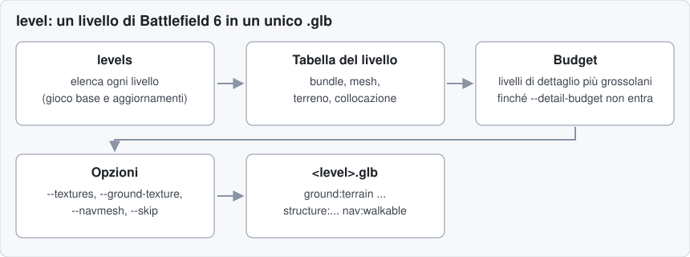

# Livelli di Battlefield 6: `levels` e `level` {#battlefield-6-levels-levels-and-level}

**Che cos'è?** Un intero livello di Battlefield 6 come un unico file 3D. **Perché?** Perché il calore delle tue
partite abbia sotto di sé il suolo e gli edifici. (*Frostbite* è il motore con cui è fatto Battlefield; una
*mappa delle altezze* è il suolo memorizzato come una griglia di altezze.)

Esporta un intero livello Frostbite del gioco installato: la mappa delle altezze del terreno, ogni mesh che i suoi
gruppi di modelli statici collocano, gli oggetti collocati uno per uno, il fondale del terreno attorno alla mappa,
e, se richiesto, le mappe colore delle superfici, le decalcomanie del terreno cotte nel suolo e le superfici
percorribili dai soldati.



## Passo per passo {#step-by-step}

1. **Elenca i livelli** che il gioco distribuisce:

   ```
   heat3d-battlefield-maps levels
   heat3d-battlefield-maps levels --install "D:\Games\<game folder>"
   ```

   Ogni riga è una tabella di livello (`levels/<level>/<level>.toc`) con la sua dimensione e la sua origine:
   `Data` per il gioco base, `Update/<pack>` per un aggiornamento.

2. **Esportane uno**, con il suo nome, una parte unica di esso, o il suo file `.toc`. Inizia senza texture per
   vedere forma e dimensione:

   ```
   heat3d-battlefield-maps level <level> -o level.glb
   ```

3. **Aggiungi colore** quando sembra giusto:

   ```
   heat3d-battlefield-maps level <level> -o level.glb --textures 512 --ground-texture 0.5
   ```

4. **Aggiungi le superfici percorribili**, oppure riduci il file:

   ```
   heat3d-battlefield-maps level <level> --textures 512 --ground-texture 0.5 --navmesh
   heat3d-battlefield-maps level <level> --textures 256 --detail-budget 3000000 --ground-spacing 8
   ```

5. **Apri `level.glb`** nel pannello Sfondo / livello del visualizzatore di 3DHeat ([caricare un livello](https://holdi601.github.io/3DHeat/levels.html)).

## Opzioni {#options}

| Opzione | Predefinito | Significato |
|---|---|---|
| `<level>` | obbligatorio | un nome come lo stampa `levels`, una parte unica di un nome, oppure il file `.toc` di un livello |
| `-o`, `--out FILE` | `<level>.glb` (in `$HEAT3D_LEVELS/<game>/` quando è impostata) | il file da scrivere |
| `--install FOLDER` | trovata nelle librerie Steam, poi nelle cartelle dell'app EA, di Origin e di Epic | la cartella del gioco |
| `--textures [PIXEL]` | disattivato; 512 se usato senza dimensione | la mappa colore di ogni superficie, al massimo PIXEL per lato |
| `--ground-texture [METRI]` | disattivato; 0,5 se usato senza dimensione | cuoce strade, piazzali e segnaletica nel colore del suolo, METRI per pixel |
| `--navmesh` | disattivato | aggiunge la mesh di navigazione del soldato come `nav:walkable` |
| `--ground-spacing METRI` | 4 | la spaziatura più fine della mappa delle altezze; 0 la lascia fuori |
| `--detail-budget N` | ogni copia al suo livello più grossolano, più un quarto, almeno 1.500.000 | un tetto sui triangoli (il terreno non viene mai reso più grossolano) |
| `--skip TESTO` | | lascia fuori i gruppi di modelli il cui nome di partizione contiene TESTO; ripetibile |
| `--by-mesh` | disattivato | una parte per mesh sorgente e materiale, per capire cos'è una parte |
| `--clamped-uvs` | disattivato | per i motori di rendering che non sanno ripetere una texture |

L'elenco completo, con le dimensioni da aspettarsi (un livello intero è centinaia di MB), è
[qui sotto](#every-option-in-full); ogni opzione come la stampa il programma è nel
[Riferimento dei comandi](../cli-reference.md). Come vengono letti tabelle, bundle, mesh e
terreno è descritto in [Frostbite](reader-frostbite.md).

## Esempio di output {#example-output}

Che cosa stampa `level`, a grandi linee (le righe come le scrive il codice; `<n>` e i nomi variano da livello a
livello):

```text
<n> copies of <n> meshes, from <n> static model groups
      <n>  <group>
      <n>  placed one by one (object and prefab references)
<n> meshes left out: <why>
<n> triangles, budget <n>; <n> meshes drawn at a coarser level to fit
           <n>  ground:terrain
           <n>  structure:buildings, <n> textures
           ...
<n> of <n> drawn sections carry their colour map; the rest are flat colours
Ground: <what the ground is>.
Navigation mesh: <tiles read>.
-> level.glb (<n> MB)
```

## Le parti {#the-parts}

`ground:terrain` (la mappa delle altezze), `ground:terrain backdrop` e `ground:terrain blend`,
`structure:<kind>` per ogni tipo di mesh (per mappa colore con `--textures`, con ` (destructible)` per ciò che una
partita può distruggere), e `nav:walkable` con `--navmesh`. Vedi [Formato di output](https://holdi601.github.io/3DHeat-GameFiles/output-format.html).

Il file contiene i contenuti del gioco: è fatto per la macchina su cui è stato creato, non per essere passato in
giro ([Termini e licenza](terms.md)).

## Dove viene trovato il gioco {#where-the-game-is-found}

Prima `--install`. Senza di esso, la prima installazione il cui `Data` contiene un
`layout.toc` (il segno di un'installazione Frostbite): in `steamapps\common` di ogni
libreria di Steam (la cartella di Steam e ogni libreria elencata nel suo `libraryfolders.vdf`),
poi nelle cartelle predefinite dell'app EA (`C:\Program Files\EA Games`),
di Origin (`C:\Program Files (x86)\Origin Games`) e del launcher Epic Games
(`C:\Program Files\Epic Games`). `levels` stampa la cartella che ha usato nella sua prima
riga, quindi eseguirlo una volta ti dice se è stato trovato il gioco giusto.

## Tutte le opzioni per esteso {#every-option-in-full}

```
heat3d-battlefield-maps levels [--install FOLDER]
heat3d-battlefield-maps level <level> [-o FILE] [--install FOLDER] [--textures [PIXELS]]
                              [--ground-texture [METRES]] [--ground-spacing METRES]
                              [--navmesh] [--detail-budget N] [--skip TEXT ...] [--by-mesh]
                              [--clamped-uvs]
```

`levels` elenca i livelli che un gioco Frostbite installato distribuisce, con il nome della
loro tabella (`levels/<level>/<level>.toc`), con la sua dimensione e la sua origine:
`Data` per il gioco base, `Update/<pack>` per un aggiornamento, e quante tabelle ad alta
risoluzione vi si aggiungono. Un livello distribuito da un aggiornamento ha una piccola tabella di
blocchi che sta anche nel gioco base; la tabella con i bundle del livello è il livello
(vedi [Frostbite](reader-frostbite.md#which-table-is-the-level)).
`level` ne esporta uno: la mappa delle altezze del terreno, ogni mesh che i gruppi di modelli statici del
livello collocano, gli oggetti collocati uno per uno, dove si trovano, e il fondale del terreno del livello
attorno alla mappa. Con `--textures`, ogni superficie porta la sua mappa colore; con `--navmesh`, vengono
incluse anche le superfici su cui camminano i soldati.

| Opzione | Predefinito | Significato |
|---|---|---|
| `<level>` | obbligatorio | un nome come lo stampa `levels`, una parte unica di un nome, oppure il percorso del `.toc` di un livello |
| `-o`, `--out FILE` | `<level>.glb` (in `$HEAT3D_LEVELS/<game>/` quando è impostata) | il `.glb` da scrivere |
| `--install FOLDER` | la prima cartella di gioco il cui `Data` contiene un `layout.toc`, [come sopra](#where-the-game-is-found) | la cartella del gioco |
| `--textures [PIXELS]` | disattivato; 512 se usato senza dimensione | scrive la mappa colore di ogni superficie, con il mip più grande al massimo di PIXELS per lato, e le sue coordinate di texture come le ha il gioco, con un campionatore che ripete (vedi [Formato di output](https://holdi601.github.io/3DHeat-GameFiles/output-format.html)). La mappa delle altezze riceve la mappa colore del fondale del terreno dove quella mappa la copre, altrimenti il colore medio dei materiali di superficie del terreno, altrimenti il colore medio del fondale intorno. Disattivato, ogni parte è a colore piatto |
| `--ground-texture [METRES]` | disattivato; 0,5 se usato senza dimensione | cuoce nel colore del suolo le decalcomanie del terreno — strade, piste, piazzali, segnaletica dipinta — moltiplicate per la mappa colore del terreno dove il livello ne ha una, nel colore della mappa delle altezze, METRES per pixel, in riquadri di al massimo 4.096 pixel (`ground:terrain x<x> z<z>`). Funziona con o senza `--textures` |
| `--navmesh` | disattivato | aggiunge la mesh di navigazione del livello per l'agente più piccolo, il soldato (alto 1,8 m, largo 0,4 m), come la parte `nav:walkable`: il suolo, i pavimenti, le scale e i tetti che un soldato può raggiungere, senza i collegamenti (salti, scale, scavalcamenti) tra di essi |
| `--ground-spacing METRES` | 4 | la spaziatura più fine della mappa delle altezze; i nodi più fitti di così vengono campionati più radi. 0 lascia fuori la mappa delle altezze |
| `--detail-budget N` | ogni copia al suo livello più grossolano, più un quarto, almeno 1.500.000 | un tetto sui triangoli. Le mesh che costano di più perdono un livello di dettaglio alla volta finché non rientrano; se nemmeno i livelli più grossolani bastano, vengono lasciate fuori per prime le copie più piccole. Il fondale del terreno non viene mai reso più grossolano né lasciato fuori |
| `--skip TEXT` | | lascia fuori i gruppi di modelli statici il cui nome di partizione contiene TEXT; ripetibile per più valori. Il layer di una modalità di gioco, per esempio |
| `--by-mesh` | disattivato | per capire cos'è una parte: una parte per mesh sorgente e materiale, chiamata `<part> \| <mesh> \| <material>`; un file molto più grande |
| `--clamped-uvs` | disattivato | per un motore di rendering che non sa ripetere una texture: taglia ogni triangolo testurizzato in pezzi le cui coordinate stanno tra 0 e 1, e disegna un triangolo che ne richiederebbe più di 4 nel colore medio della sua texture, in una parte `<part> (average colour)` |

Stampa i gruppi e quante copie ha collocato ciascuno, le mesh lasciate fuori e
perché, i triangoli per parte (e con `--textures` quante texture, e quante sezioni hanno trovato la loro mappa colore),
che cosa è il suolo, e con `--navmesh` quante tessere di navigazione sono state lette. Non viene scritto nulla sul livello
oltre alla geometria: né nomi, né metadati (vedi [Formato di output](https://holdi601.github.io/3DHeat-GameFiles/output-format.html)).

Il budget del terreno è separato: la mappa delle altezze e il fondale non vengono mai resi più grossolani da
`--detail-budget`; `--ground-spacing` dimensiona la mappa delle altezze.

Un livello intero è grande: di solito oltre dieci milioni di triangoli e diverse centinaia di MB.
`--textures` aggiunge un po' al file; un livello ricco di alberi può arrivare a circa 1 GB.
`--textures 256 --detail-budget 3000000 --ground-spacing 8` porta un livello a circa un terzo di
quella dimensione.

## Messaggi e stato di uscita {#messages-and-exit-status}

| Messaggio | Uscita | Significa |
|---|---|---|
| `no Frostbite game found in a Steam library or the EA app's, Origin's or Epic's folder; give --install <the game's folder>` | 2 | installa il gioco, oppure passa `--install` |
| `needs 3DHeat GameFiles: ...` | 2 | installa 3DHeat GameFiles ([Prima di iniziare](before-you-start.md)) |
| qualsiasi altra cosa, dopo i conteggi | 1 | non è stato possibile leggere una tabella di livello o un bundle; la riga dice quale |

0 vuol dire che il livello è stato scritto; la sua ultima riga è `-> <file> (<n> MB)`.

## Tramite 3DHeat GameFiles {#through-3dheat-gamefiles}

I comandi `levels` e `level` di 3DHeat GameFiles eseguono questo strumento con gli stessi
argomenti, quindi `python -m heat3d_gamefiles level <level> -o level.glb` fa la stessa cosa
una volta che entrambi sono installati.
