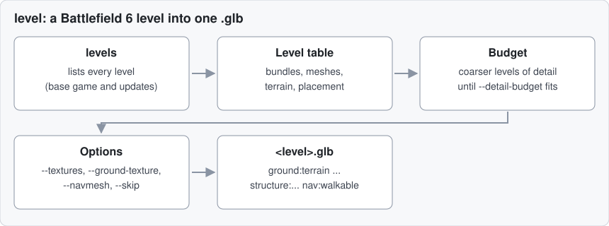

# Battlefield 6 levels: `levels` and `level`

**What is it?** A whole Battlefield 6 level as one 3D file. **Why?** So heat
from your matches has the ground and buildings under it. (*Frostbite* is the
engine Battlefield is made with; a *heightfield* is the ground stored as a grid
of heights.)

Exports a whole Frostbite level of the installed game: the terrain heightfield,
every mesh its static model groups place, the objects placed one by one, the
terrain backdrop around the map, and on request the surfaces' colour maps, the
terrain decals baked into the ground and the soldiers' walkable surfaces.



## Step by step

1. **List the levels** the game ships:

   ```
   heat3d-battlefield-maps levels
   heat3d-battlefield-maps levels --install "D:\Games\<game folder>"
   ```

   Each line is a level table (`levels/<level>/<level>.toc`) with its size and
   where it comes from: `Data` for the base game, `Update/<pack>` for an update.

2. **Export one**, by its name, a unique part of it, or its `.toc` path. Start
   untextured to see the shape and the size:

   ```
   heat3d-battlefield-maps level <level> -o level.glb
   ```

3. **Add colour** once it looks right:

   ```
   heat3d-battlefield-maps level <level> -o level.glb --textures 512 --ground-texture 0.5
   ```

4. **Add the walkable surfaces**, or shrink the file:

   ```
   heat3d-battlefield-maps level <level> --textures 512 --ground-texture 0.5 --navmesh
   heat3d-battlefield-maps level <level> --textures 256 --detail-budget 3000000 --ground-spacing 8
   ```

5. **Open `level.glb`** in the 3DHeat viewer's Background / level panel ([loading a level](https://holdi601.github.io/3DHeat/levels.html)).

## Options

| Option | Default | Meaning |
|---|---|---|
| `<level>` | required | a name as `levels` prints it, a unique part of one, or a level's `.toc` |
| `-o`, `--out FILE` | `<level>.glb` (in `$HEAT3D_LEVELS/<game>/` when that is set) | the file to write |
| `--install FOLDER` | found in the Steam libraries, then the EA app's, Origin's and Epic's folders | the game's folder |
| `--textures [PIXELS]` | off; 512 without a size | each surface's colour map, at most PIXELS a side |
| `--ground-texture [METRES]` | off; 0.5 without a size | bake roads, aprons and markings into the ground's colour, METRES a pixel |
| `--navmesh` | off | add the soldier's navigation mesh as `nav:walkable` |
| `--ground-spacing METRES` | 4 | the heightfield's finest spacing; 0 leaves it out |
| `--detail-budget N` | coarsest copies plus a quarter, at least 1,500,000 | a ceiling on triangles (the terrain is never coarsened) |
| `--skip TEXT` | | leave out model groups whose partition name contains TEXT; repeatable |
| `--by-mesh` | off | one part per source mesh and material, for finding what a part is |
| `--clamped-uvs` | off | for renderers that cannot repeat a texture |

The full table, with the sizes to expect (a whole level is hundreds of MB), is
[below](#every-option-in-full); every option as the program prints it is on
[Command reference](cli-reference.md). How the tables, bundles, meshes and
terrain are read is on [Frostbite](reader-frostbite.md).

## Example output

What `level` prints, in outline (the lines as the code writes them; `<n>` and
the names vary by level):

```text
<n> copies of <n> meshes, from <n> static model groups
      <n>  <group>
      <n>  placed one by one (object and prefab references)
<n> meshes left out: <why>
<n> triangles, budget <n>; <n> meshes drawn at a coarser level to fit
           <n>  ground:terrain
           <n>  structure:buildings, <n> textures
           ...
<n> of <n> drawn sections carry their colour map; the rest are flat colours
Ground: <what the ground is>.
Navigation mesh: <tiles read>.
-> level.glb (<n> MB)
```

## The parts

`ground:terrain` (the heightfield), `ground:terrain backdrop` and
`ground:terrain blend`, `structure:<kind>` per kind of mesh (per colour map
with `--textures`, with ` (destructible)` for what a match can destroy), and
`nav:walkable` with `--navmesh`. See [Output format](https://holdi601.github.io/3DHeat-GameFiles/output-format.html).

The file holds the game's content: it is for the machine it was made on, not
for passing around ([Terms and licence](terms.md)).

## Where the game is found

`--install` first. Without it, the first game whose `Data` folder holds a
`layout.toc` (the mark of a Frostbite install): in `steamapps\common` of every
Steam library (Steam's own folder and each library its `libraryfolders.vdf`
lists), then in the default folders of the EA app (`C:\Program Files\EA Games`),
Origin (`C:\Program Files (x86)\Origin Games`) and the Epic Games launcher
(`C:\Program Files\Epic Games`). `levels` prints the folder it used on its
first line, so running it once tells you whether the right game was found.

## Every option in full

```
heat3d-battlefield-maps levels [--install FOLDER]
heat3d-battlefield-maps level <level> [-o FILE] [--install FOLDER] [--textures [PIXELS]]
                              [--ground-texture [METRES]] [--ground-spacing METRES]
                              [--navmesh] [--detail-budget N] [--skip TEXT ...] [--by-mesh]
                              [--clamped-uvs]
```

`levels` lists the levels an installed Frostbite game ships, by the name of
their table (`levels/<level>/<level>.toc`), with its size and where it comes
from: `Data` for the base game, `Update/<pack>` for an update, and how many
high-resolution tables add to it. A level an update ships has a small table of
chunks only in the base game as well; the table with the level's bundles is the
level (see [Frostbite](reader-frostbite.md#which-table-is-the-level)).
`level` exports one: the terrain heightfield, every mesh the level's static
model groups place, the objects placed one by one, where they stand, and the
level's terrain backdrop round the map. With `--textures`, every surface carries
its colour map; with `--navmesh`, the surfaces soldiers walk on come too.

| Option | Default | Meaning |
|---|---|---|
| `<level>` | required | a name as `levels` prints it, a unique part of one, or the path of a level's `.toc` |
| `-o`, `--out FILE` | `<level>.glb` (in `$HEAT3D_LEVELS/<game>/` when that is set) | the `.glb` to write |
| `--install FOLDER` | the first game whose `Data` holds a `layout.toc`, [as above](#where-the-game-is-found) | the game's folder |
| `--textures [PIXELS]` | off; 512 when given without a size | write each surface's colour map, the largest mip no bigger than PIXELS a side, and its texture coordinates as the game has them, with a repeating sampler (see [Output format](https://holdi601.github.io/3DHeat-GameFiles/output-format.html)). The heightfield gets the terrain backdrop's colour map where that map covers it, else the middle colour of the terrain's surface materials, else the backdrop's average colour round it. Off, every part is a flat colour |
| `--ground-texture [METRES]` | off; 0.5 when given without a size | bake the terrain decals — roads, runways, aprons, painted markings — over the ground colour, multiplied by the terrain's colour map where the level has one, into the heightfield's colour, METRES a pixel, in tiles of at most 4,096 pixels (`ground:terrain x<x> z<z>`). Works with or without `--textures` |
| `--navmesh` | off | add the level's navigation mesh for its smallest agent, the soldier (1.8 m tall, 0.4 m wide), as the part `nav:walkable`: the ground, floors, stairs and the roofs a soldier can reach, without the links (jumps, ladders, vaults) between them |
| `--ground-spacing METRES` | 4 | the heightfield's finest spacing; nodes finer than this are sampled down. 0 leaves the heightfield out |
| `--detail-budget N` | every copy at its coarsest level, plus a quarter, at least 1,500,000 | a ceiling on triangles. The meshes costing most drop a level of detail at a time until it fits; if even the coarsest levels do not, the smallest copies are left out first. The terrain backdrop is never coarsened or left out |
| `--skip TEXT` | | leave out static model groups whose partition name contains TEXT; repeat it for several. A game mode's layer, for instance |
| `--by-mesh` | off | for finding what a part is: one part per source mesh and material, named `<part> \| <mesh> \| <material>`; a much larger file |
| `--clamped-uvs` | off | for a renderer that cannot repeat a texture: cut every textured triangle into pieces whose coordinates lie within 0..1, and draw a triangle that would need more than 4 pieces in its texture's average colour, in a part `<part> (average colour)` |

It prints the groups and how many copies each placed, the meshes it left out and
why, the triangles per part (and with `--textures` how many textures, and how
many sections found their colour map), what the ground is, and with
`--navmesh` how many navigation tiles were read. Nothing is written about the level beyond the
geometry: no names, no metadata (see [Output format](https://holdi601.github.io/3DHeat-GameFiles/output-format.html)).

The terrain budget is separate: the heightfield and the backdrop are never
coarsened by `--detail-budget`; `--ground-spacing` sizes the heightfield.

A whole level is large: typically over ten million triangles and several
hundred MB. `--textures` adds a little to the file; a level thick with trees
can reach about 1 GB. `--textures 256 --detail-budget 3000000 --ground-spacing 8`
brings a level to roughly a third of that.

## Messages and exit status

| Message | Exit | Means |
|---|---|---|
| `no Frostbite game found in a Steam library or the EA app's, Origin's or Epic's folder; give --install <the game's folder>` | 2 | install the game, or pass `--install` |
| `needs 3DHeat GameFiles: ...` | 2 | install 3DHeat GameFiles ([Before you start](before-you-start.md)) |
| anything else, after the counts | 1 | a level table or bundle could not be read; the line says which |

0 means the level was written; its last line is `-> <file> (<n> MB)`.

## Through 3DHeat GameFiles

3DHeat GameFiles' own `levels` and `level` run this tool with the same
arguments, so `python -m heat3d_gamefiles level <level> -o level.glb` does the
same once both are installed.
